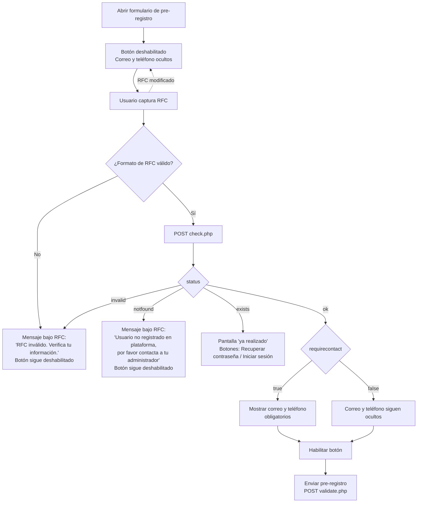

# Pre-registro: validación previa de RFC y captura condicional de correo/teléfono

**Alcance para:** Moodle App custom de CMSindical
**Origen:** plugin `local_preenroll` (versión `2026102300`), ya implementado en web
**Fecha:** 2026-10-23

---

## 1. Resumen

Hoy el formulario de pre-registro siempre pide correo y teléfono. Con este cambio el formulario pasa a ser dinámico:

1. Al abrir el formulario, el botón **"Enviar pre-registro"** está **deshabilitado** y los campos **correo** y **teléfono** están **ocultos**.
2. Al capturar el RFC, la app llama a un **servicio nuevo (`check.php`)** que:
   - valida que el RFC corresponda a un usuario de la plataforma;
   - indica si ese usuario **debe capturar correo y teléfono**, según su campo `institution`.
3. Según la respuesta, se muestran u ocultan correo y teléfono, y al final del ciclo **se habilita el botón**.

La app **no** necesita conocer las instituciones configuradas. El servidor decide y solo devuelve `requirecontact: true | false`.

> Solo se migra este alcance. Recuperación de contraseña (`recover.php`) y los textos del SMS no cambian para la app.

---

## 2. Flujo



**Regla clave:** si el usuario **modifica el RFC** en cualquier momento, el formulario regresa al estado inicial: botón deshabilitado, correo y teléfono ocultos, mensaje limpio. Después se valida de nuevo.

---

## 3. Servicios

Base: `{siteurl}/local/preenroll/`
Método: `POST` con parámetros de formulario (`application/x-www-form-urlencoded` o `multipart/form-data`).
No requieren token (el flujo es previo al login). CORS ya permite cualquier origen.

### 3.1 `check.php` (nuevo, solo lectura)

Solo consulta: no escribe en la BD ni envía SMS.

**Request**

| Parámetro | Tipo | Obligatorio | Notas |
|---|---|---|---|
| `rfc` | string | Sí | El servidor lo normaliza (trim + mayúsculas) |

**Responses** (siempre HTTP 200 con JSON, salvo método no permitido)

| `status` | Campos extra | Qué hace la app |
|---|---|---|
| `ok` | `requirecontact: boolean` | Mostrar u ocultar correo y teléfono según el valor y habilitar el botón |
| `notfound` | `message` | Mostrar `message` bajo el RFC y mantener el botón deshabilitado |
| `invalid` | `message` | Mostrar `message` bajo el RFC y mantener el botón deshabilitado |
| `exists` | `message` | Reemplazar el formulario por la pantalla "ya realizado" (igual que hoy cuando `validate.php` responde `exists`) |
| `error` | `message` | Solo con método distinto de POST (HTTP 405) |

Ejemplos reales (entorno de desarrollo):

```json
{"status":"ok","requirecontact":true,"validationcode":"RFC_OK"}
{"status":"ok","requirecontact":false,"validationcode":"RFC_OK"}
{"status":"notfound","message":"Usuario no registrado en plataforma, por favor contacta a tu administrador","validationcode":"USER_NOT_FOUND"}
{"status":"invalid","message":"RFC inválido. Verifica tu información.","validationcode":"INVALID_RFC"}
{"status":"exists","message":"Este proceso ya lo realizaste previamente. Ingresa con tu usuario y contraseña recibidos por SMS.","validationcode":"ALREADY_REGISTERED"}
```

### 3.2 `validate.php` (existente, con cambios)

**Request**

| Parámetro | Obligatorio | Cuándo enviarlo |
|---|---|---|
| `rfc` | Sí | Siempre |
| `telefono` | Condicional | **Solo** si `check.php` respondió `requirecontact: true`. Solo dígitos, 10 caracteres |
| `email` | Condicional | **Solo** si `check.php` respondió `requirecontact: true` |

**Cambios del lado servidor que la app debe conocer**

- El servidor **vuelve a evaluar** la institución y no confía en lo que envíe la app:
  - con `requirecontact = false`, ignora `telefono` y `email` aunque se envíen;
  - con `requirecontact = true`, los valida y, si son incorrectos, responde `invalid`.
- Responses posibles:

| `status` | `validationcode` | Qué hace la app |
|---|---|---|
| `ok` | `NOT_REGISTERED` | Pantalla de éxito con `message` y sin botones de acción |
| `exists` | `ALREADY_REGISTERED` | Pantalla "ya realizado" con "Recuperar contraseña" e "Iniciar sesión" |
| `invalid` | `INVALID_RFC` / `INVALID_PHONE` / `INVALID_EMAIL` | **Nuevo.** Mostrar `message` en el área de error del formulario, rehabilitar el botón y no cerrar el formulario |
| `notel` | `NO_PHONE` | Mostrar `message` en el área de error. Ocurre cuando el usuario no requiere contacto y no tiene teléfono registrado |
| `error` | `METHOD_NOT_ALLOWED` | Mostrar `message` en el área de error |

> Para cualquier `status` desconocido, mostrar `message` si viene o, si no, "Error inesperado en la validación.".

---

## 4. Reglas de UI en la app

### Estado inicial (al abrir el formulario)
- Campos visibles: Nombre(s), Apellido(s), RFC.
- Correo y Teléfono: **ocultos y excluidos de la validación del formulario**. En Angular/Ionic, quitarles `Validators.required` o deshabilitar los controles con `control.disable()`; si no, el formulario queda inválido aunque no se vean.
- Botón "Enviar pre-registro": **deshabilitado**.

### Disparo de la validación del RFC
- Normalizar el valor a mayúsculas mientras se escribe.
- Llamar a `check.php` cuando:
  - el RFC llegue a **13 caracteres** (con debounce de ~300 ms), o
  - el campo **pierda el foco** (`ionBlur`). Con menos de 13 caracteres, mostrar el mensaje de RFC inválido sin llamar al servicio.
- Validar el formato localmente antes de llamar (mismo patrón que el servidor):

  ```
  ^[A-ZÑ&]{4}\d{6}[A-Z0-9]{3}$
  ```

- Mientras la petición está en curso, mostrar "Validando RFC..." con un spinner pequeño bajo el campo.

### Control de concurrencia
- Si el RFC cambia mientras hay una petición en curso, **cancelarla** (`unsubscribe` / `switchMap` en RxJS) o descartar su respuesta.
- No lanzar una segunda petición para el mismo RFC si ya hay una en curso (por ejemplo, cuando el blur llega justo después del debounce).
- Opcional: guardar en memoria las respuestas `ok`/`notfound` por RFC mientras el formulario esté abierto, y limpiarlas al cerrarlo.

### Cuando `requirecontact = true`
- Mostrar Correo y Teléfono, ambos **obligatorios**.
- Teléfono: solo dígitos, exactamente 10 (`inputmode="numeric"`, `maxlength="10"`).
- Correo: formato válido (`^[^\s@]+@[^\s@]+\.[^\s@]+$`), máximo 100 caracteres.

### Envío
- Antes de enviar, confirmar que el RFC actual es el mismo que pasó por `check.php`. Si no, volver a validarlo y no enviar.
- Validaciones locales: nombre y apellido obligatorios (máximo 100 caracteres); correo y teléfono solo si `requirecontact = true`.
- **Deshabilitar el botón mientras responde `validate.php`** para evitar dobles envíos (y dobles SMS). Rehabilitarlo si la respuesta es de error.

---

## 5. Textos

| Caso | Texto | Dónde |
|---|---|---|
| RFC con formato inválido | RFC inválido. Verifica tu información. | Bajo el campo RFC |
| RFC no vinculado a usuario | Usuario no registrado en plataforma, por favor contacta a tu administrador | Bajo el campo RFC |
| Validando | Validando RFC... | Bajo el campo RFC |
| Falla de red en `check.php` | No se pudo validar el RFC. Intenta de nuevo. | Bajo el campo RFC |
| Nombre vacío / largo | El nombre es obligatorio. / El nombre no puede exceder 100 caracteres. | Área de error |
| Apellido vacío / largo | El apellido es obligatorio. / El apellido no puede exceder 100 caracteres. | Área de error |
| Teléfono | El teléfono debe tener 10 dígitos. | Área de error |
| Correo | Correo electrónico inválido. Verifica tu información. | Área de error |

Los textos de `exists`, `ok` y `notel` llegan en `message` desde el servidor; usar ese valor tal cual.

---

## 6. Configuración (solo informativo)

En **Administración del sitio → Extensiones → Extensiones locales → Pre-registro** existe el ajuste **"Instituciones que requieren correo y teléfono"** (`local_preenroll/institutions`):

- Es un multiselect con los valores distintos del campo `institution` de los usuarios.
- Si no se selecciona ninguno, se usa **`CONALEP`**.
- La comparación no distingue mayúsculas e ignora espacios al inicio y al final.

La app **no** lee este ajuste. Todo se resuelve con `requirecontact`.

---

## 7. Compatibilidad con versiones anteriores de la app

Una versión anterior de la app (que siempre pide y envía correo y teléfono, sin llamar a `check.php`) sigue funcionando:

- Para usuarios de instituciones **no** configuradas, el servidor ignora correo y teléfono.
- Puede recibir dos `status` que antes no existían en `validate.php`: `invalid` (RFC con formato incorrecto) y `notel`. Conviene confirmar que la versión anterior muestra el `message` en esos casos.

---

## 8. Casos de prueba

| # | Escenario | Resultado esperado |
|---|---|---|
| 1 | Abrir el formulario | Botón deshabilitado; correo y teléfono ocultos |
| 2 | RFC con formato inválido (`abc`) y salir del campo | Mensaje "RFC inválido..."; botón deshabilitado; sin llamada a `check.php` |
| 3 | RFC válido no registrado (`XAXX010101000`) | Mensaje "Usuario no registrado en plataforma..."; botón deshabilitado |
| 4 | RFC de usuario con institución configurada (p. ej. CONALEP) | Se muestran correo y teléfono obligatorios; botón habilitado |
| 5 | RFC de usuario con otra institución | Correo y teléfono ocultos; botón habilitado |
| 6 | RFC con pre-registro ya realizado | Pantalla "ya realizado" con Recuperar contraseña / Iniciar sesión |
| 7 | Tras el caso 4, modificar un carácter del RFC | Regresa al estado inicial y se vuelve a validar |
| 8 | Caso 4 con teléfono de 9 dígitos o correo inválido | Error local; no se llama a `validate.php` |
| 9 | Caso 4 o 5 y enviar | Pantalla de éxito; un solo envío aunque se toque el botón varias veces |
| 10 | RFC capturado en minúsculas | Se normaliza a mayúsculas y el flujo funciona igual |
| 11 | Sin conexión durante `check.php` | "No se pudo validar el RFC. Intenta de nuevo."; botón deshabilitado |

RFCs disponibles en el entorno de desarrollo (`https://desarrollo.portal3i.mx/7725-cmsindicato`):

| RFC | Resultado en `check.php` |
|---|---|
| `ABCD123456IEA` | `ok`, `requirecontact: true` |
| `DUCL010816P85` | `ok`, `requirecontact: false` |
| `GALL8112154C6` | `exists` |
| `XAXX010101000` | `notfound` |

> Los casos 9 y posteriores sobre `validate.php` envían un SMS real y escriben en la BD. Usar usuarios de prueba.

---

## 9. Referencia en web

La implementación web de este flujo está en `local/preenroll/form.js` (funciones `checkRfc`, `applyRfcResult`, `resetRfcState`, `setContactVisible` y el manejador `submit`). Puede usarse como referencia de comportamiento.
